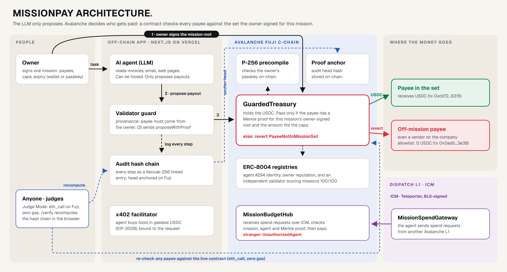

# MissionPay

> **LLMs can be fooled. Budgets on Avalanche can't.** The owner signs who a mission may pay; the AI agent can only propose; `GuardedTreasury` on Avalanche rejects every payout outside the signed set, even to a vendor already on the company allowlist.

[](https://github.com/lenamkhanhh/UniHack/actions/workflows/ci.yml)


| Live demo | Demo video (2:28) | Pitch deck | Verify it yourself |
|---|---|---|---|
| [unihack-missionpay.vercel.app](https://unihack-missionpay.vercel.app) | [Watch on Google Drive](https://drive.google.com/file/d/1OqQu5Q_XHDf-owe6r5xeLyeEydrrYO7Z/view) | [Google Slides](https://docs.google.com/presentation/d/1MSbomuT7qXj2MCg6taqkS6tEqdVH_VybzS5wTcQAKHY) · [PDF](artifacts/submission-s1/MissionPay-pitch-deck-v2.pdf) | [Judge Mode](https://unihack-missionpay.vercel.app/judge) · [/verify](https://unihack-missionpay.vercel.app/verify/fuji-live-mission-s1c) |

Team **BaKhiDeVuong** · Avalanche Team1 Vietnam UniHack 2026.



## How it works

1. **The owner signs a mission once.** Goal, caps, expiry and the set of allowed payees (a Merkle root), with a wallet or a passkey checked on-chain by Avalanche's P-256 precompile. The backend never holds the owner's key.
2. **The agent only proposes.** The validator checks where every recipient address came from (owner vs. web page or tool output) and the caps, and logs every step into a Keccak-256 hash chain.
3. **Avalanche decides.** `GuardedTreasury` pays only a payee with a valid Merkle proof for this mission's root. Anything else reverts `PayeeNotInMissionSet`, even if the LLM was fully fooled and our server compromised.

**The proof that matters, live on Fuji (13/11/2026):** the same allowlisted vendor and the same treasury. The allowlist-only mission paid it ([0x548d…7fc6](https://testnet.snowtrace.io/tx/0x548d1106a69626eed32d308088f188c6d2d71d8e2f61e495f637d9f04e367fc6)); the payee-set mission reverted `PayeeNotInMissionSet` ([0x0ad5…3e38](https://testnet.snowtrace.io/tx/0x0ad53adcf5790523e22219dcadc2c69b1a783d22c0bf651a9fa4742b43783e38)); the approved payee was still paid ([0xcb72…6315](https://testnet.snowtrace.io/tx/0xcb7236d146a2c8e2789db8ec2a80358b17d65993fc7b07187802e34c48656315)). GuardedTreasury: [`0x20451c1e…d545`](https://testnet.snowtrace.io/address/0x20451c1e2dCD83F166B4f22868BAdECb5868d545).

---

## 1. Evidence by rubric (judge in 60 seconds)

| Criterion (points) | What is built | Primary files | Verify | On-chain |
|---|---|---|---|---|
| **Tech (25)** | GuardedTreasury with per-mission Merkle payee sets, root snapshotting and invariant fuzzing; gasless x402 / EIP-3009 tool payments; WebAuthn P-256 passkey authority; provenance guard SDK. | `contracts/src/GuardedTreasury.sol`<br>`apps/web/lib/`<br>`packages/guard/` | `forge test --summary` (111 passed, 512 invariant runs / 32,768 calls)<br>`npx vitest run --root apps/web` (355 tests, CI green)<br>`npx vitest run --root packages/guard` (19 passed) | GuardedTreasury: [`0x20451c1e…`](https://testnet.snowtrace.io/address/0x20451c1e2dCD83F166B4f22868BAdECb5868d545)<br>Audit head anchor: [`0x43bd21b8…`](https://testnet.snowtrace.io/tx/0x43bd21b81248a9f1a4dc2ff037a3df8119ae098690cd4e353bdbb4ce6ceb0547) |
| **Avalanche (25)** | C-Chain settlement on Fuji; EIP-3009 facilitator; ERC-8004 identity, reputation and validation; **ICM live between Dispatch L1 and Fuji** (agent spend sent on Dispatch and executed on Fuji; stranger rejected). | `contracts/src/MissionBudgetHub.sol`<br>`contracts/src/MissionSpendGateway.sol`<br>`contracts/src/ValidationRegistry.sol`<br>`apps/web/lib/erc8004.ts` | `forge test --match-contract MissionCrossChainICMTest` (12 passed)<br>`npx vitest run --root apps/web tests/erc8004.test.ts` | Unapproved payout reverted: [`0xc5f13e5d…`](https://testnet.snowtrace.io/tx/0xc5f13e5d2986633182ba8d69d5560429b063c5bf5f871c6908962933fea4f1ff)<br>ICM spend executed: [`0x5641b631…`](https://testnet.snowtrace.io/tx/0x5641b631aba7a1dd2edd8516ded5b0ffa6c09b97029f6cf36800860f8ed1443b)<br>Agent #294: [`0xb5646950…`](https://testnet.snowtrace.io/tx/0xb5646950b8a1541b5b18a3812b8c17b7c3abc88fb91b0857bd142dd9991507c8) |
| **Creativity (15)** | A payee set per mission instead of one company allowlist, signed once by passkey; a public bounty arena where the LLM can be fooled but the contract still says no. | `apps/web/app/bounty/`<br>`contracts/src/PasskeyMissionAuthority.sol` | `npx vitest run --root apps/web tests/bounty.test.ts`<br>`forge test --match-contract PasskeyGovernanceTest` (32 passed) | Live arena: `/bounty`, `/arena/twin` |
| **Impact (15)** | AgentDojo banking, live Gemini 3.1 Flash-Lite: 31/48 attacks succeed without a guard, **2/48 with MissionPay** (both where the user's own prompt names the attacker). Replay: 120/128 blocked; Fuji fork: 150/150 reverted with the attacker on the allowlist. PayBench-ADI: 0/277 attack runs moved money, 40/40 legitimate tasks passed. | `eval/agentdojo/LIVE_SUMMARY.md`<br>`eval/agentdojo/SUMMARY.md`<br>`eval/README.md` | `python -m unittest eval/agentdojo/test_provguard_pairs.py` (14 passed) | Replay JSON: `eval/agentdojo/results/` |
| **Pitch (10)** | 15-slide deck in the same paper/ink design as the app; narrated 2:28 demo video. | `artifacts/submission-s1/MissionPay-pitch-deck-v2.pdf`<br>`docs/pitch/` | `node artifacts/submission-s1/deck-v2/build_deck.js` | [Slides](https://docs.google.com/presentation/d/1MSbomuT7qXj2MCg6taqkS6tEqdVH_VybzS5wTcQAKHY) · [Video](https://drive.google.com/file/d/1OqQu5Q_XHDf-owe6r5xeLyeEydrrYO7Z/view) |
| **UI/UX (10)** | Bilingual (EN/VI) Next.js app, colour by meaning (red blocked, green paid), Judge Mode against the live contract, passkey onboarding, in-browser audit verification. Playwright E2E (42 tests) green in CI. | `apps/web/app/`<br>`apps/web/lib/i18n.tsx` | `npx playwright test` | `/verify/fuji-live-mission-s1c` (ERC-8004 100/100, [tx](https://testnet.snowtrace.io/tx/0xa9f7faddb9e15f0efdb94349f49aed63a5af30666a9edeeffbb5fe8814af5ffa)) |

---

## 2. Known limitations

1. **ICM delivery.** Live on testnet (20/11): `MissionSpendGateway` on Dispatch ([`0x20451c1e…`](https://subnets-test.avax.network/dispatch/address/0x20451c1e2dCD83F166B4f22868BAdECb5868d545)) and `MissionBudgetHub` on Fuji ([`0x8Ba595B3…`](https://testnet.snowtrace.io/address/0x8Ba595B37b2206Df29D05Cf8fE42477eEB426fE3)). Authorized spend executed ([`0x5641…443b`](https://testnet.snowtrace.io/tx/0x5641b631aba7a1dd2edd8516ded5b0ffa6c09b97029f6cf36800860f8ed1443b), 0.10 USDC); stranger rejected `UnauthorizedAgent` ([`0xdd99…341d`](https://testnet.snowtrace.io/tx/0xdd99bfd754ea2f200581c3ab08d8245799c203f114d820677a85356b3f40341d), 0 USDC). Both deliveries were made by a public ICM relayer; our self-relay (`scripts/m9-self-relay.ts`, Glacier BLS aggregation) produced a valid signed message but arrived a block later. Receipts: `evidence/m9/icm-live.json`.
2. **AgentDojo misses (`user_task_15`).** In every miss the user's own prompt sets the attacker's IBAN as the new landlord. MissionPay treats the owner's one-time mission signature as the human check; an agent cannot tell user intent from user error.
3. **Owner can reset a root to 0.** That falls back to the global allowlist. It is public: `MissionPayeeRootSet` is emitted and `policyVersion` increments.
4. **Deployed bytecode on Fuji is the earlier version.** Root snapshotting (A1) and passkey governance (A3) are in `contracts/src/` and covered by 111 Foundry tests, but not redeployed, so the live Twin Treasury evidence stays tied to one address.
5. **Hardware biometrics.** Passkey checks are verified with P-256 test vectors and WebAuthn virtual authenticators; a physical biometric prompt on live Fuji is `NOT_RUN`.

---

## 3. Quickstart

Prerequisites: Node.js 20+, npm 10+, Foundry (`forge`), Python 3.10+, PostgreSQL for the web tests.

```bash
npm install
npm run verify:all          # forge tests, guard SDK, web tests, tsc, AgentDojo unit tests
cd apps/web && npx prisma migrate deploy && cd ../..
npm run dev -- -p 3100      # http://localhost:3100
```

Useful routes: `/judge` (live contract checks), `/arena/twin` (Twin Treasury receipts), `/bounty` (public challenge), `/verify/fuji-live-mission-s1c` (audit chain).

---

## 4. Repository layout

```
apps/web/            Next.js app: agent, validator, x402 rails, Judge Mode, verifier, bounty arena
contracts/           Foundry: GuardedTreasury, passkey authority, ICM hub/gateway, ValidationRegistry
packages/guard/      Provenance guard SDK (used by the app and by the AgentDojo defense)
packages/mcp/        MCP server exposing MissionPay to agent frameworks
eval/                AgentDojo live + replay, PayBench-ADI cases and results
evidence/            On-chain receipts and exports (Fuji missions, Twin Treasury, ICM live)
scripts/             Fuji runners, ICM self-relay, validator, video build
artifacts/           Submission deck, video, screenshots
docs/                Architecture, security notes, deploy runbook, pitch material, research
```

## 5. Documentation

| Topic | Files |
|---|---|
| Architecture | [`docs/architecture.svg`](docs/architecture.svg) |
| Security and formal checks | [`docs/security/FORMAL.md`](docs/security/FORMAL.md), [`docs/security/ATTACK_EVAL.md`](docs/security/ATTACK_EVAL.md), [`docs/security/ADAPTIVE_ATTACK.md`](docs/security/ADAPTIVE_ATTACK.md), [`SECURITY.md`](SECURITY.md) |
| Avalanche specifics | [`docs/avalanche/PASSKEY.md`](docs/avalanche/PASSKEY.md), [`docs/avalanche/m9-self-relay-spike.md`](docs/avalanche/m9-self-relay-spike.md), [`artifacts/submission-s1/FUJI_EVIDENCE.md`](artifacts/submission-s1/FUJI_EVIDENCE.md) |
| Pitch and judge Q&A | [`docs/pitch/JUDGE_QA.md`](docs/pitch/JUDGE_QA.md), [`docs/pitch/VIDEO_SCRIPT.md`](docs/pitch/VIDEO_SCRIPT.md) |
| Deploy | [`docs/deploy/DEPLOY_RUNBOOK.md`](docs/deploy/DEPLOY_RUNBOOK.md), [`docs/deploy/DEPLOY_CHECKLIST.md`](docs/deploy/DEPLOY_CHECKLIST.md) |
| Research and design history | [`docs/research/`](docs/research/), [`docs/design/pipeline/`](docs/design/pipeline/), [`docs/review-history/`](docs/review-history/) |
