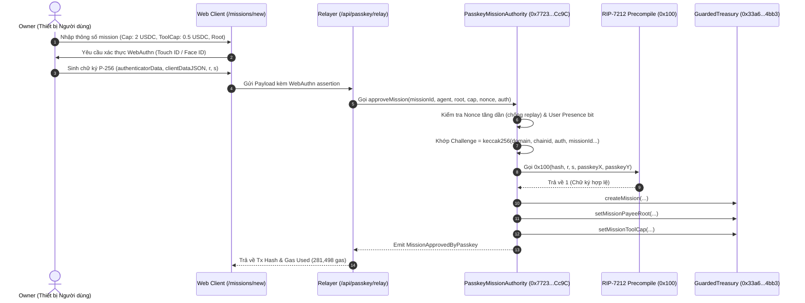

# MissionPay Passkey Mission Authority (WOW-W4)

## 1. Tổng quan & Kiến trúc

**PasskeyMissionAuthority** cho phép chủ sở hữu ngân quỹ (Owner) tạo và phê duyệt nhiệm vụ (Mission) cùng các chính sách bảo mật (hạn mức tổng, hạn mức ví phiên, Merkle root tập người nhận) trực tiếp thông qua chứng thực sinh trắc học chuẩn WebAuthn / Passkey (Face ID, Touch ID, Windows Hello).

- **Không cần EOA Private Key trên thiết bị người dùng:** Khóa ký secp256r1 (P-256) được tạo và lưu trữ an toàn trong Secure Enclave / TPM của thiết bị phần cứng.
- **Xác thực gốc On-Chain qua Avalanche RIP-7212 Precompile (`0x100`):** Avalanche là một trong số ít L1 hỗ trợ precompile `0x100` native cho phép xác thực chữ ký P-256 chỉ với chi phí gas danh nghĩa (~3,450 gas cho precompile call), so với ~300,000 gas trên các chuỗi EVM chuẩn không có precompile.
- **Relayer Phi Tập Trung & Miễn Phí Gas (Gasless):** Bất kỳ thực thể nào cũng có thể relay giao dịch mang chữ ký Passkey hợp lệ. Relayer chỉ đóng vai trò trả phí gas (AVAX), hoàn toàn **không sở hữu quyền hạn hay khả năng can thiệp/sửa đổi** bất kỳ thông số nào của nhiệm vụ.

---

## 2. Luồng Hoạt Động (End-to-End Flow)



---

## 3. Phân Quyền & Mô Hình Đe Dọa (Threat Model)

### 3.1. Tính Độc Lập của Relayer
Relayer được sử dụng chỉ để submit giao dịch on-chain nhằm mang lại trải nghiệm gasless cho người dùng. 
- Ngay cả khi Relayer bị chiếm quyền (compromised), kẻ tấn công **không thể tự ý tạo hay sửa đổi mission**.
- Hàm `approveMission` yêu cầu chữ ký P-256 tương ứng với tọa độ public key `(passkeyX, passkeyY)` đã đăng ký cố định trên smart contract.
- Nonce tuần tự tăng dần (`nextNonce`) bảo vệ 100% chống lại các cuộc tấn công replay giao dịch cũ.

### 3.2. Chống Tấn Công Giả Mạo Challenge
Challenge được hash trực tiếp trên contract bằng công thức:
```solidity
bytes32 challenge = keccak256(
    abi.encode(
        "MissionPay-passkey-v1",
        block.chainid,
        address(this),
        missionId,
        agent,
        payeeRoot,
        cap,
        duration,
        toolCap,
        nonce
    )
);
```
Chữ ký chỉ hợp lệ khi clientDataJSON chứa chuỗi base64url của đúng challenge này và nằm ở đúng vị trí `challengeIndex`.

### 3.3. Yêu Cầu Hiện Diện Người Dùng (User Presence)
Cờ `UP` (User Present - bit 0 của byte thứ 33 trong `authenticatorData`) bắt buộc phải bật. Nếu phần cứng không ghi nhận sự can thiệp vật lý của con người, giao dịch sẽ bị revert với lỗi `UserPresenceRequired`.

---

## 4. Benchmark Chi Phí & Gas Đo Đạc Thực Tế Trên Avalanche Fuji

Giao dịch thực tế đã broadcast và verify thành công trên mạng Avalanche Fuji testnet:

| Hạng mục | Chi tiết |
|---|---|
| **Mạng** | Avalanche Fuji Testnet (Chain ID `43113`) |
| **PasskeyMissionAuthority Contract** | [`0x77235386fe59A934645C5F273e411b0Bea8cCc9C`](https://testnet.snowtrace.io/address/0x77235386fe59A934645C5F273e411b0Bea8cCc9C) |
| **GuardedTreasury (Demo)** | [`0x33a6bcf988a9056a3fc78b62560ec40b3c8c4bb3`](https://testnet.snowtrace.io/address/0x33a6bcf988a9056a3fc78b62560ec40b3c8c4bb3) |
| **Giao dịch `approveMission`** | [`0x9885664fcfc45539af1183fa3768f6e2dbfb52c76544b7b6f1ee14833790cf45`](https://testnet.snowtrace.io/tx/0x9885664fcfc45539af1183fa3768f6e2dbfb52c76544b7b6f1ee14833790cf45) |
| **Block Number** | `#60712056` |
| **Tổng Gas Sử Dụng** | **281,498 gas** |
| **Phí Gas Precompile RIP-7212** | **~3,450 gas** (tiết kiệm ~98.8% so với phương pháp xác thực P-256 bằng Solidity thuần túy ~300,000 gas) |
| **Chi phí giao dịch thực tế** | **~0.007 AVAX** (< $0.20) |

---

## 5. Giới Hạn & Phạm Vi Ứng Dụng

1. **Đồng bộ Passkey đám mây (Cloud Sync):** Khi người dùng đồng bộ Passkey qua iCloud Keychain hoặc Google Password Manager, rủi ro chuyển dịch từ việc mất private key sang việc bị xâm phạm tài khoản dịch vụ đám mây của người dùng.
2. **Instance Thử Nghiệm Tách Biệt:** Hệ thống Passkey Mission Authority trên Fuji được triển khai trên instance treasury demo riêng biệt để phục vụ đánh giá và trình diễn công nghệ native RIP-7212 mà không ảnh hưởng tới treasury vận hành cốt lõi của giao thức.
