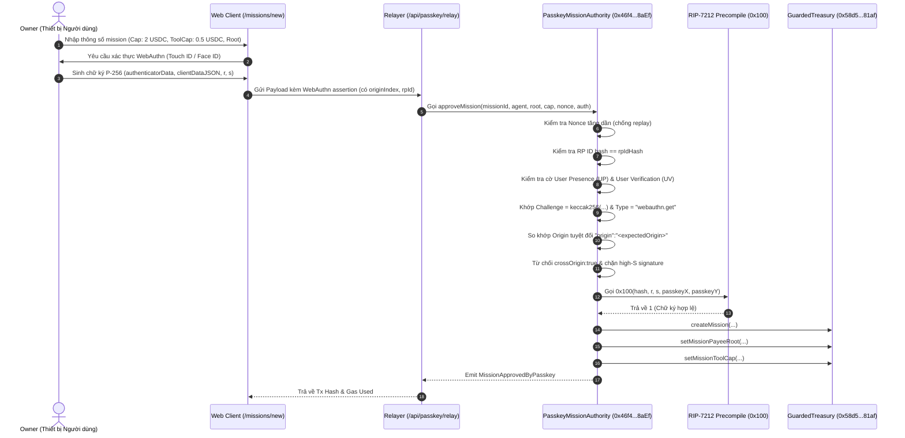

# MissionPay Passkey Mission Authority (WOW-W4 & PK-F1)

## 1. Tổng quan & Kiến trúc

**PasskeyMissionAuthority** cho phép chủ sở hữu ngân quỹ (Owner) tạo và phê duyệt nhiệm vụ (Mission) cùng các chính sách bảo mật (hạn mức tổng, hạn mức ví phiên, Merkle root tập người nhận) trực tiếp thông qua chứng thực sinh trắc học chuẩn WebAuthn / Passkey (Face ID, Touch ID, Windows Hello).

- **Không cần EOA Private Key trên thiết bị người dùng:** Khóa ký secp256r1 (P-256) được tạo và lưu trữ an toàn trong Secure Enclave / TPM của thiết bị phần cứng.
- **Xác thực gốc On-Chain qua Avalanche RIP-7212 Precompile (`0x100`):** Avalanche là một trong số ít L1 hỗ trợ precompile `0x100` native cho phép xác thực chữ ký P-256 chỉ với chi phí gas danh nghĩa (~3,450 gas cho precompile call), so với ~300,000 gas trên các chuỗi EVM chuẩn không có precompile.
- **Bảo Mật Cấp Độ Ngân Hàng (PK-F1 Hardened):** Tương đương các chuẩn WebAuthn khắt khe nhất trong Web3 (ngang hàng allowance-ai trên NEAR), hợp đồng kiểm tra toàn diện: RP ID hash, so khớp origin tuyệt đối có dấu nháy đóng (ngăn chặn triệt để subdomain prefix trick), cờ User Presence (UP bit 0) và User Verification (UV bit 2), từ chối `crossOrigin:true`, và chống malleability high-S.
- **Relayer Phi Tập Trung & Miễn Phí Gas (Gasless):** Bất kỳ thực thể nào cũng có thể relay giao dịch mang chữ ký Passkey hợp lệ. Relayer chỉ đóng vai trò trả phí gas (AVAX), hoàn toàn **không sở hữu quyền hạn hay khả năng can thiệp/sửa đổi** bất kỳ thông số nào của nhiệm vụ.

---

## 2. Luồng Hoạt Động (End-to-End Flow)

---

## 3. Bảng Kiểm Tra WebAuthn & Bộ Kiểm Thử (PK-F1)

| Hạng mục kiểm tra WebAuthn | Cơ chế thực thi trong Smart Contract | Tên Test Foundry (`contracts/test/`) | Mục tiêu ngăn chặn |
|---|---|---|---|
| **RP ID Hash** | `bytes32(auth.authenticatorData[:32]) == rpIdHash` | `test_wrongRpIdHash_reverts` | Ngăn chặn kẻ tấn công dùng chữ ký sinh từ website/ứng dụng khác |
| **Origin So Khớp Tuyệt Đối** | `_matchesSubsequence(clientBytes, auth.originIndex, '"origin":"' + expectedOrigin + '"')` | `test_phishingOrigin_reverts` | Ngăn chặn phishing qua domain mạo danh |
| **Origin Prefix Bypass Trick** | Bắt buộc đóng dấu nháy kép `"` ngay sau URL origin | `test_originPrefixTrick_reverts` | Ngăn chặn bypass dạng `http://localhost:3100.evil.com` |
| **User Presence (UP)** | `(uint8(auth.authenticatorData[32]) & 0x01) != 0` | `test_approveMission_missingUserPresence_reverts` | Đảm bảo người dùng có mặt bấm xác nhận vật lý |
| **User Verification (UV)** | `if (requireUV) (auth.authenticatorData[32] & 0x04) != 0` | `test_userPresentWithoutVerification_reverts` | Bắt buộc sinh trắc học (Face ID/Touch ID/PIN), từ chối nếu chỉ bấm nút UP |
| **Ceremony Type Matching** | `_matchesSubsequence(..., '"type":"webauthn.get"')` | `test_registrationCeremonyAsAssertion_reverts` | Ngăn chặn dùng lại chữ ký lễ đăng ký (`webauthn.create`) làm lệnh duyệt chi |
| **High-S Malleability Protection** | `require(auth.s <= SECP256R1_HALF_N)` | `test_highS_reverts` | Chống can thiệp malleability chữ ký P-256 trên EVM |
| **Cross-Origin Rejection** | `!_contains(clientBytes, '"crossOrigin":true')` | `test_crossOriginTrue_reverts` | Chống giả mạo context qua iframe cross-origin |
| **Passkey Rotation Security** | Toàn bộ các check trên được áp dụng khi gọi `rotatePasskey` | `test_rotatePasskey_requiresSameChecks` | Đảm bảo đổi khóa passkey mới vẫn phải xác thực đầy đủ |

---

## 4. Benchmark Chi Phí & Gas Thực Tế Trên Avalanche Fuji

Hai instance độc lập đã được triển khai và ghi nhận on-chain trên Avalanche Fuji Testnet (Chain ID `43113`):

| Hạng mục | Bản Ban Đầu (Pre-Hardening) | Bản Nâng Cấp (PK-F1 Hardened) |
|---|---|---|
| **PasskeyMissionAuthority** | [`0x77235386fe59A934645C5F273e411b0Bea8cCc9C`](https://testnet.snowtrace.io/address/0x77235386fe59A934645C5F273e411b0Bea8cCc9C) | [`0x46f48bece672266541d73d752684859a8f3c8aef`](https://testnet.snowtrace.io/address/0x46f48bece672266541d73d752684859a8f3c8aef) |
| **GuardedTreasury (Demo)** | [`0x33a6bcf988a9056a3fc78b62560ec40b3c8c4bb3`](https://testnet.snowtrace.io/address/0x33a6bcf988a9056a3fc78b62560ec40b3c8c4bb3) | [`0x58d5bcd57c3cf089dc93b0e3f5f6def3a69a81af`](https://testnet.snowtrace.io/address/0x58d5bcd57c3cf089dc93b0e3f5f6def3a69a81af) |
| **Giao dịch `approveMission`** | [`0x9885664f...3790cf45`](https://testnet.snowtrace.io/tx/0x9885664fcfc45539af1183fa3768f6e2dbfb52c76544b7b6f1ee14833790cf45) | [`0x494b664be33d2c2d08575884f3ceb546779e8c7eb8eaec0bed171a11f0d7a929`](https://testnet.snowtrace.io/tx/0x494b664be33d2c2d08575884f3ceb546779e8c7eb8eaec0bed171a11f0d7a929) |
| **Block Number** | `#60712056` | `#60724328` |
| **Gas Sử Dụng** | **281,498 gas** | **400,354 gas** (Bao gồm full checks: RP ID hash, origin, UV flag, RIP-7212) |
| **Phí Gas Precompile RIP-7212** | ~3,450 gas | ~3,450 gas |
| **Chi phí giao dịch thực tế** | ~0.000000028 AVAX | ~0.000000041 AVAX (< $0.0001) |

---

## 5. Giới Hạn & Phạm Vi Ứng Dụng

1. **Origin và RP ID Cố Định theo Bản Triển Khai:** `rpIdHash` (sha256 của RP ID) và `expectedOrigin` được thiết lập cố định tại thời điểm deploy hợp đồng (ví dụ: RP ID `"localhost"` và origin `"http://localhost:3100"` trong môi trường phát triển và demo). Khi chuyển giao thức sang tên miền public (ví dụ `https://missionpay.ai`), Owner chỉ cần chạy script `scripts/passkey-deploy-for-owner.ts --rp-id missionpay.ai --origin https://missionpay.ai --broadcast` để khởi tạo authority instance mới cho tên miền sản xuất.
2. **Khóa Phần Mềm trong RAM cho CI/CD:** Script demo `scripts/passkey-fuji-demo.ts` tạo cặp khóa P-256 phần mềm trong RAM để tự động hóa kiểm thử live. Để deploy authority liên kết với khóa sinh trắc học phần cứng thực tế của Owner, sử dụng `scripts/passkey-deploy-for-owner.ts` cùng tọa độ `(qx, qy)` xuất từ `/missions/new`.
3. **Đồng bộ Passkey đám mây (Cloud Sync):** Khi người dùng đồng bộ Passkey qua iCloud Keychain hoặc Google Password Manager, rủi ro chuyển dịch từ việc mất private key sang việc bị xâm phạm tài khoản dịch vụ đám mây của người dùng.
4. **Instance Thử Nghiệm Tách Biệt:** Hệ thống Passkey Mission Authority trên Fuji được triển khai trên instance treasury demo riêng biệt để phục vụ đánh giá và trình diễn công nghệ native RIP-7212 mà không ảnh hưởng tới treasury vận hành cốt lõi của giao thức.
